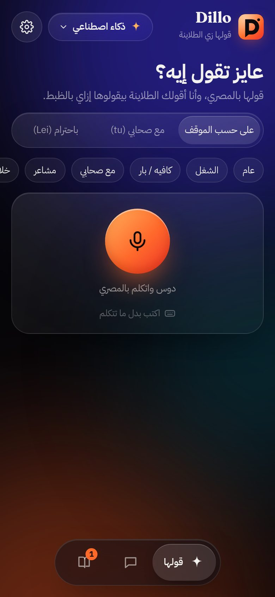
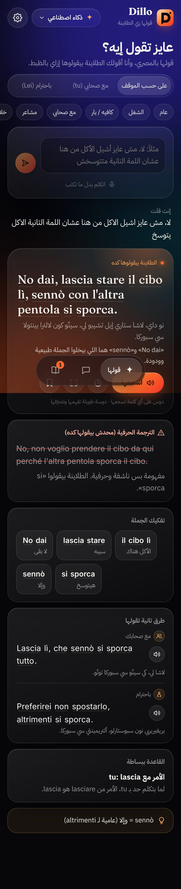
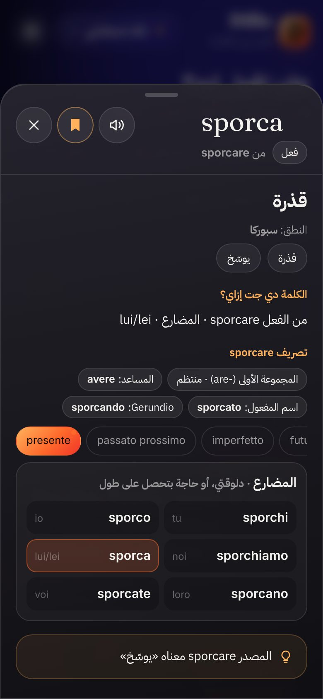
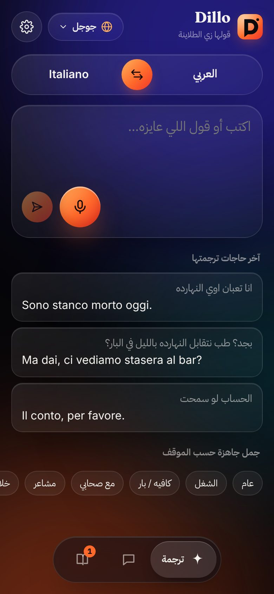
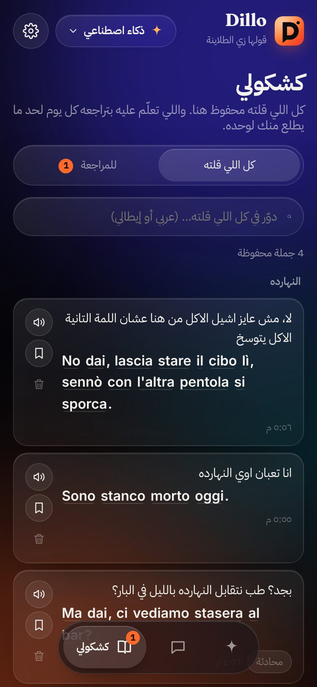
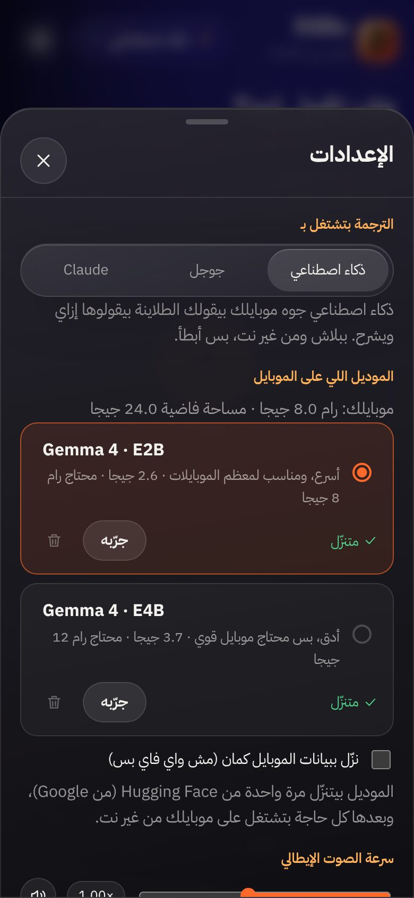

# Dillo UI · نظام التصميم

نظام تصميم غامق ومريح للعين: **زجاج (glass) فوق خلفية سودا فيها أضواء ملونة مطفية**، ومعاه لون مميز واحد هو تدرج برتقالي اسمه **Aperol**. اتعمل لتطبيق Dillo، بس مكتوب بحيث تقدر تستخدمه في **أي تطبيق أو موقع أو تصميم تاني**:
- كل القيم جاهزة للنسخ: CSS و JSON و Tailwind.
- كل عنصر معاه الكود بتاعه.
- في الآخر قواعد الاستخدام، والأيقونات بكود SVG.

> **الشكل الحقيقي:** شاشات Dillo متصورة في [`screens/`](screens/). وفيه ملف عرض مرئي في [`Dillo-UI-Design.html`](Dillo-UI-Design.html).

---

## 1. الفكرة في سطرين

| المبدأ | يعني إيه |
|---|---|
| **غامق وهادي** | الخلفية شبه سودا (`#07070A`)، والنص أبيض دافي مش أبيض صريح. |
| **زجاج فوق ضوء** | الكروت شفافة ومعمولها blur، وتحتها 3 أضواء ملونة مطفية. ده اللي بيدي الإحساس البريميوم. |
| **لون مميز واحد بس** | تدرج Aperol للحاجة الأهم في الشاشة (زرار أو مايك). متكتّرش منه. |
| **كل حاجة دايرية** | الأزرار والاختيارات `999px`، والكروت من `22` لـ `30px`. |
| **عربي من اليمين، ولاتيني من الشمال** | الواجهة RTL، وأي نص لاتيني أو كود بياخد `dir="ltr"`. |

---

## 2. الألوان (Tokens)

### الأساسية
| الاسم | Token | القيمة | الاستخدام |
|---|---|---|---|
| Background | `--bg` | `#07070A` | خلفية التطبيق كله |
| Text | `--text` | `#F4F2EF` | النص الأساسي |
| Muted | `--muted` | `rgba(244,242,239,0.58)` | النص الثانوي والشرح |
| Faint | `--faint` | `rgba(244,242,239,0.34)` | التلميحات والأيقونات الباهتة |
| Line | `--line` | `rgba(255,255,255,0.11)` | حدود الكروت والأزرار |
| Line strong | `--line-strong` | `rgba(255,255,255,0.20)` | حد أوضح (حاجة متختارة أو مهمة) |
| Glass | `--glass` | `rgba(255,255,255,0.055)` | خلفية العناصر الصغيرة |
| Glass strong | `--glass-strong` | `rgba(255,255,255,0.09)` | خلفية الأزرار العادية |

### اللون المميز
| الاسم | Token | القيمة | الاستخدام |
|---|---|---|---|
| **Aperol** | `--accent` | `#FF6A2B` | اللون الأساسي: التعليم والتركيز وحالة "شغال" |
| **Peach** | `--accent-2` | `#FFB15C` | عناوين صغيرة وأيقونات مميزة |
| **Ember** | — | `#F0362A` | آخر التدرج |
| **التدرج** | `--accent-grad` | `linear-gradient(135deg, #FFB15C 0%, #FF6A2B 55%, #F0362A 100%)` | الزرار الأساسي، والمايك، واللوجو |
| نص فوق التدرج | — | `#120804` | أي نص أو أيقونة فوق البرتقالي (مش أبيض) |

### الحالة
| الاسم | Token | القيمة |
|---|---|---|
| نجاح | `--ok` | `#4FD18B` |
| خطأ | `--bad` | `#FF5D5D` |
| تحذير (نص) | — | `#FFCF8A` |

### أضواء الخلفية
تلات دواير ملونة عليها `filter: blur(90px)`، وبتتحرك ببطء:

| الضوء | اللون | المكان | الشفافية |
|---|---|---|---|
| Indigo | `#3A2FD8` | فوق يمين، 520px | 0.55 |
| Orange | `#FF5A1F` | تحت شمال، 460px | 0.38 |
| Teal | `#0F6F86` | النص، 340px | 0.30 |

---

## 3. الخطوط

| الدور | الخط | التقيل | المقاس |
|---|---|---|---|
| الواجهة بالعربي | **IBM Plex Sans Arabic** | 400 · 500 · 600 · 700 | النص 16px، العنوان 28px |
| الجملة المهمة (Display) | **Fraunces** | 500 · 600 | من 26 لـ 34px، والشاشة الكاملة لحد 64px |
| النص اللاتيني العادي | **Inter** | 400 · 500 · 600 | من 15 لـ 18px |

```html
<link href="https://fonts.googleapis.com/css2?family=Fraunces:opsz,wght@9..144,400..700&family=IBM+Plex+Sans+Arabic:wght@400;500;600;700&family=Inter:wght@400;500;600&display=swap" rel="stylesheet">
```

**المقاسات:**

| الاستخدام | المقاس | التقيل |
|---|---|---|
| عنوان الشاشة | `1.75rem` (28px) | 700 |
| الجملة الكبيرة (Fraunces) | `clamp(1.6rem, 6vw, 2.1rem)` | 500 |
| النص | `1rem` (16px) | 400 |
| عنوان الكارت | `0.85rem` | 600، بلون `--muted` |
| الصغير | `0.82rem` | 400 |
| التلميح | `0.72rem` | 400، بلون `--faint` |

ارتفاع السطر `1.6` للعربي، و `1.25` للعناوين الكبيرة.

---

## 4. المقاسات والمسافات

| الحاجة | القيمة |
|---|---|
| الهامش على جنب الشاشة | `16px` |
| أقصى عرض للمحتوى | `640px` (في نص الشاشة) |
| المسافة بين الكروت | `12–14px` |
| حواف الكارت العادي | `22px` |
| حواف الكارت الكبير والـ Bottom sheet | `30px` |
| الأزرار والاختيارات والشريط اللي تحت | `999px` |
| زرار الأيقونة | `44 × 44` (والصغير `34 × 34`) |
| ارتفاع الزرار العادي | `46px` |
| المايك | `92px` (والمتوسط `58px`) |
| أقل مساحة للمس | `44px` |

**الظلال:**
- **الكارت:** `inset 0 1px 0 rgba(255,255,255,.12), 0 20px 50px -20px rgba(0,0,0,.6)`
- **الزرار البرتقالي:** `0 10px 30px -10px rgba(255,106,43,.7), inset 0 1px 0 rgba(255,255,255,.4)`

**الحركة:**
- **الضغط:** `transform: scale(0.97)`، أو `0.92` لزرار الأيقونة، في `150ms`.
- **ظهور العناصر:** `rise`، ويعني `translateY(8px)` و `opacity 0`، في `350ms ease`.
- **الـ Bottom sheet:** `translateY(40%)`، في `320ms cubic-bezier(.2,.9,.3,1)`.
- **احترام `prefers-reduced-motion`:** لو المستخدم قافل الحركة، بنوقف كل الأنيميشن.

---

## 5. الكود الأساسي (انسخه في أي مشروع)

```css
:root {
  --bg: #07070a;
  --text: #f4f2ef;
  --muted: rgba(244, 242, 239, 0.58);
  --faint: rgba(244, 242, 239, 0.34);
  --glass: rgba(255, 255, 255, 0.055);
  --glass-strong: rgba(255, 255, 255, 0.09);
  --line: rgba(255, 255, 255, 0.11);
  --line-strong: rgba(255, 255, 255, 0.2);
  --accent: #ff6a2b;
  --accent-2: #ffb15c;
  --accent-grad: linear-gradient(135deg, #ffb15c 0%, #ff6a2b 55%, #f0362a 100%);
  --on-accent: #120804;
  --ok: #4fd18b;
  --bad: #ff5d5d;
  --radius: 26px;
  --ar: "IBM Plex Sans Arabic", system-ui, sans-serif;
  --latin: "Inter", system-ui, sans-serif;
  --display: "Fraunces", Georgia, serif;
  color-scheme: dark;
}

body {
  margin: 0;
  background: var(--bg);
  color: var(--text);
  font-family: var(--ar);
  font-size: 16px;
  line-height: 1.6;
  -webkit-font-smoothing: antialiased;
}

/* الزجاج: أهم كلاس في النظام */
.glass {
  background: linear-gradient(160deg, rgba(255, 255, 255, 0.085), rgba(255, 255, 255, 0.025));
  border: 1px solid var(--line);
  box-shadow: inset 0 1px 0 rgba(255, 255, 255, 0.12), 0 20px 50px -20px rgba(0, 0, 0, 0.6);
  backdrop-filter: blur(22px) saturate(140%);
  -webkit-backdrop-filter: blur(22px) saturate(140%);
}

/* أضواء الخلفية */
.bg { position: fixed; inset: 0; overflow: hidden; z-index: 0; pointer-events: none; }
.bg i { position: absolute; border-radius: 50%; filter: blur(90px); }
.bg .b1 { width: 520px; height: 520px; top: -200px; right: -160px; background: #3a2fd8; opacity: .55; }
.bg .b2 { width: 460px; height: 460px; bottom: -220px; left: -180px; background: #ff5a1f; opacity: .38; }
.bg .b3 { width: 340px; height: 340px; top: 40%; left: 50%; background: #0f6f86; opacity: .3; }
```

```html
<div class="bg" aria-hidden="true"><i class="b1"></i><i class="b2"></i><i class="b3"></i></div>
```

### JSON (لـ Figma Tokens أو React Native أو Flutter)
```json
{
  "color": {
    "bg": "#07070A",
    "text": "#F4F2EF",
    "muted": "rgba(244,242,239,0.58)",
    "faint": "rgba(244,242,239,0.34)",
    "line": "rgba(255,255,255,0.11)",
    "lineStrong": "rgba(255,255,255,0.20)",
    "glass": "rgba(255,255,255,0.055)",
    "glassStrong": "rgba(255,255,255,0.09)",
    "accent": "#FF6A2B",
    "accent2": "#FFB15C",
    "ember": "#F0362A",
    "onAccent": "#120804",
    "ok": "#4FD18B",
    "bad": "#FF5D5D",
    "glowIndigo": "#3A2FD8",
    "glowOrange": "#FF5A1F",
    "glowTeal": "#0F6F86"
  },
  "gradient": { "accent": { "angle": 135, "stops": [["#FFB15C", 0], ["#FF6A2B", 0.55], ["#F0362A", 1]] } },
  "radius": { "chip": 999, "button": 999, "card": 22, "cardLarge": 30, "sheet": 30, "word": 6 },
  "size": { "gutter": 16, "maxWidth": 640, "iconButton": 44, "button": 46, "mic": 92, "minTouch": 44 },
  "font": {
    "arabic": "IBM Plex Sans Arabic",
    "display": "Fraunces",
    "latin": "Inter",
    "sizeBody": 16,
    "sizeTitle": 28,
    "sizeDisplay": 32,
    "sizeSmall": 13
  },
  "glass": { "blur": 22, "saturate": 1.4, "fillFrom": 0.085, "fillTo": 0.025, "border": 0.11, "highlight": 0.12 }
}
```

### Tailwind (`tailwind.config.js`)
```js
export default {
  theme: {
    extend: {
      colors: {
        bg: "#07070A", ink: "#F4F2EF", accent: "#FF6A2B", peach: "#FFB15C", ember: "#F0362A",
        ok: "#4FD18B", bad: "#FF5D5D", "on-accent": "#120804",
      },
      fontFamily: { ar: ["IBM Plex Sans Arabic", "sans-serif"], display: ["Fraunces", "serif"], latin: ["Inter", "sans-serif"] },
      borderRadius: { card: "22px", "card-lg": "30px" },
      backgroundImage: { aperol: "linear-gradient(135deg,#FFB15C 0%,#FF6A2B 55%,#F0362A 100%)" },
    },
  },
};
```

---

## 6. العناصر (Components)

### الزرار
| النوع | الشكل | إمتى |
|---|---|---|
| **أساسي** | تدرج Aperol، ونص `#120804`، وظل برتقالي | أهم حاجة في الشاشة (مرة واحدة بس) |
| **عادي** | `--glass-strong` وحد `--line` | باقي الأفعال |
| **أيقونة** | دايرة 44px | أفعال سريعة (اسمع، احفظ، اقفل) |
| **شبح (ghost)** | من غير خلفية ولا حد، ولون `--faint` | أفعال خطيرة أو ثانوية (امسح) |

```css
.btn {
  display: inline-flex; align-items: center; justify-content: center; gap: 8px;
  height: 46px; padding: 0 20px; border-radius: 999px; font-weight: 600;
  background: var(--glass-strong); border: 1px solid var(--line); color: var(--text);
  transition: transform .15s;
}
.btn:active { transform: scale(.97); }
.btn.primary {
  background: var(--accent-grad); color: var(--on-accent); border: 0;
  box-shadow: 0 10px 30px -10px rgba(255,106,43,.7), inset 0 1px 0 rgba(255,255,255,.4);
}
.icon-btn {
  display: grid; place-items: center; width: 44px; height: 44px; border-radius: 50%;
  background: rgba(255,255,255,.07); border: 1px solid var(--line); color: var(--text);
}
.icon-btn.on { color: var(--accent-2); border-color: rgba(255,177,92,.5); } /* محفوظ أو مفعّل */
```

### المايك (الزرار البطل)
دايرة بالتدرج، مضيئة ومجسّمة. وهو شغال بيطلع منه حلقتين بيكبروا ويختفوا.
```css
.mic {
  position: relative; display: grid; place-items: center; width: 92px; height: 92px; border-radius: 50%;
  color: var(--on-accent); background: var(--accent-grad);
  box-shadow: 0 18px 40px -12px rgba(255,106,43,.75), inset 0 2px 0 rgba(255,255,255,.45), inset 0 -6px 14px rgba(160,30,0,.35);
}
.mic-ring { position: absolute; inset: -1px; border-radius: 50%; border: 2px solid rgba(255,140,80,.6); opacity: 0; }
.mic.live .mic-ring { animation: ring 1.6s ease-out infinite; }
.mic.live .mic-ring.r2 { animation-delay: .8s; }
@keyframes ring { 0% { transform: scale(1); opacity: .9 } 100% { transform: scale(1.7); opacity: 0 } }
```

### الكارت
```css
.card { border-radius: 22px; padding: 16px 18px; }                        /* + class="glass" */
.card-title { font-size: .85rem; font-weight: 600; color: var(--muted); margin-bottom: 10px; }
.hero { position: relative; overflow: hidden; border-radius: 30px; padding: 20px 20px 16px; }
.hero::before { /* ضوء برتقالي في الركن */
  content: ""; position: absolute; inset: -40% -20% auto auto; width: 260px; height: 260px;
  background: radial-gradient(circle, rgba(255,106,43,.35), transparent 65%); pointer-events: none;
}
```
**أنواع الكروت:**
- **عادي:** الزجاج زي ما هو.
- **تحذير:** عنوان بلون `#FFB3A1` ونص متشطب.
- **نصيحة:** خلفية `rgba(255,177,92,.08)` وحد `rgba(255,177,92,.25)`.
- **خطأ:** خلفية `rgba(255,93,93,.10)` وحد `rgba(255,93,93,.35)`.

### Chips (اختيارات صغيرة)
```css
.chip { padding: 6px 12px; border-radius: 999px; background: var(--glass); border: 1px solid var(--line); font-size: .82rem; white-space: nowrap; }
.chip.active { background: rgba(255,106,43,.16); border-color: rgba(255,106,43,.55); color: #ffd2bd; }
```
لو الـ chips كتير، حطهم في صف واحد بيتسحب بالعرض (`overflow-x: auto`)، ومن غير scrollbar.

### Segmented (اختيار واحد من كذا حاجة)
```css
.seg { display: flex; padding: 4px; border-radius: 999px; }                 /* + glass */
.seg button { flex: 1; padding: 9px 6px; border-radius: 999px; font-size: .85rem; color: var(--muted); }
.seg button.active { color: var(--text); background: rgba(255,255,255,.12); box-shadow: inset 0 1px 0 rgba(255,255,255,.18); }
```

### الشريط اللي تحت (Dock)
كبسولة عايمة في نص الشاشة من تحت. التاب المختار بيكبر ويظهر اسمه، والباقيين أيقونة بس.
```css
.dock { position: fixed; left: 50%; bottom: calc(16px + env(safe-area-inset-bottom)); transform: translateX(-50%);
  display: flex; gap: 4px; padding: 6px; border-radius: 999px; background: rgba(20,20,26,.6); }   /* + glass */
.dock-item { display: flex; align-items: center; gap: 8px; height: 52px; padding: 0 16px; border-radius: 999px; color: var(--muted); }
.dock-item span { max-width: 0; overflow: hidden; white-space: nowrap; transition: max-width .3s; }
.dock-item.active { color: var(--text); background: rgba(255,255,255,.12); }
.dock-item.active span { max-width: 90px; }
.badge { position: absolute; top: 6px; right: 8px; min-width: 17px; height: 17px; border-radius: 9px;
  background: var(--accent); color: var(--on-accent); font-size: .68rem; font-weight: 700; display: grid; place-items: center; }
```

### Bottom sheet
```css
.sheet-backdrop { position: fixed; inset: 0; background: rgba(0,0,0,.55); backdrop-filter: blur(6px); display: flex; align-items: flex-end; justify-content: center; }
.sheet { width: 100%; max-width: 640px; max-height: 88dvh; border-radius: 30px 30px 0 0;
  background: linear-gradient(170deg, rgba(40,38,48,.92), rgba(16,16,20,.96));
  animation: up .32s cubic-bezier(.2,.9,.3,1) both; }
.sheet-grip { width: 40px; height: 5px; border-radius: 3px; background: rgba(255,255,255,.2); margin: 10px auto 0; }
@keyframes up { from { transform: translateY(40%); opacity: 0 } }
```

### كلمة تقدر تدوس عليها
الكلمة عليها خط رفيع تحتها. **الدوسة العادية** بتنطقها، و**الدوسة الطويلة** (420ms) بتفتح الشرح. وانت ضاغط بتنوّر برتقالي.
```css
.w { border-radius: 6px; padding: 0 1px; user-select: none; -webkit-touch-callout: none;
  background-image: linear-gradient(transparent calc(100% - 1px), rgba(255,255,255,.16) 0); }
.w.pressing { background-color: rgba(255,106,43,.25); box-shadow: 0 0 0 3px rgba(255,106,43,.18); }
```

### جدول (صفوف بالتعليم)
```css
.conj { display: grid; grid-template-columns: 1fr 1fr; gap: 6px; }
.conj-row { display: flex; justify-content: space-between; padding: 8px 10px; border-radius: 12px; background: rgba(0,0,0,.2); }
.conj-row.here { background: rgba(255,106,43,.18); box-shadow: inset 0 0 0 1px rgba(255,106,43,.5); }  /* الصف المهم */
```

### Emblem (للشاشات الفاضية)
دايرة زجاج 76px وجواها أيقونة، ووراها ضوء برتقالي. **بدل الإيموجي.**
```css
.emblem { position: relative; width: 76px; height: 76px; margin: 0 auto 14px; }
.emblem-glow { position: absolute; inset: -14px; border-radius: 50%; background: radial-gradient(circle, rgba(255,106,43,.45), transparent 65%); filter: blur(6px); }
.emblem-core { position: absolute; inset: 0; display: grid; place-items: center; border-radius: 50%; color: #ffd2bd;
  background: linear-gradient(160deg, rgba(255,255,255,.16), rgba(255,255,255,.03)); border: 1px solid var(--line-strong);
  box-shadow: inset 0 1px 0 rgba(255,255,255,.3), inset 0 -10px 20px rgba(255,106,43,.15), 0 12px 30px -10px rgba(0,0,0,.7); }
```

### حالات التحميل
- **Skeleton:** خطوط بتلمع، `linear-gradient` بيتحرك في `1.2s`.
- **بيكتب:** 3 نقط بتنبض.
- **بيفكر:** دايرة صغيرة بالتدرج بتنبض جنب نص هادي ("بفكر…").

### الشاشة الكاملة (Show mode)
عكس الثيم: خلفية فاتحة دافية (`#F6F1EA`)، ونص `#0B0B0E` بخط Fraunces لحد 64px. عشان تتقري من بعيد.

---

## 7. الأيقونات

- **الستايل:** خط بس (stroke)، سُمكه **1.8**، على شبكة **24×24**، وأطرافه دايرية (`round`).
- **اللون:** `currentColor`، يعني بتاخد لون النص اللي حواليها.
- **المقاسات:** **16** جوه الأزرار الصغيرة، **20** جوه زرار الأيقونة، و **22** في الشريط اللي تحت.
- **ممنوع الإيموجي والأعلام.** في الشاشات الفاضية استخدم **Emblem**.

كود الـ 28 أيقونة موجود في آخر الملف.

---

## 8. RTL والعربي

- `<html lang="ar" dir="rtl">`.
- **أي نص لاتيني** (إيطالي أو إنجليزي أو أكواد) ياخد `dir="ltr"` والخط اللاتيني، حتى لو جوه كارت عربي.
- **الأيقونات اللي ليها اتجاه** (سهم، إرسال) اقلبها في RTL لو معناها اتجاه.
- **الأرقام والكود** في كتلة `ltr` لوحدها، عشان الترتيب ميتلخبطش.
- **استخدم `margin-inline-start` و `padding-inline-end`** بدل left و right.

---

## 9. قواعد سريعة

**اعمل كده:**
- لون برتقالي **واحد** بارز في كل شاشة.
- كل كارت **زجاج** فوق الأضواء.
- النصوص الثانوية بـ `--muted`، مش بلون تاني.
- مسافات ثابتة: 16px على الجناب، و 12–14px بين الكروت.
- أي عنصر بيتلمس **مش أصغر من 44px**.

**متعملش كده:**
- ❌ أبيض صريح `#FFFFFF` للنص، أو أسود صريح للخلفية.
- ❌ أكتر من زرار برتقالي في نفس المكان.
- ❌ إيموجي أو أعلام بدل الأيقونات.
- ❌ زوايا حادة (أقل حاجة 6px).
- ❌ ظلال سودا تقيلة من غير blur.

**التباين (Accessibility):** دي نسب محسوبة على الخلفية `#07070A`:

| النص | التباين | ينفع لإيه |
|---|---|---|
| `--text` | **18:1** | أي حاجة |
| `--muted` | **6.2:1** | النص الثانوي والشرح |
| `--faint` | **2.8:1** | التلميحات والتزيين بس، **مش لأي معلومة مهمة** |
| `#120804` على `#FFB15C` / `#FF6A2B` / `#F0362A` | **11 / 6.9 / 5.0** | نص الزرار البرتقالي |

المعيار المطلوب للنص العادي (WCAG AA) هو **4.5:1**.

---

## 10. اللوجو

حرف **D** أسود (`#0B0B0E`) على شكل فقاعة كلام، والدايرة الصغيرة جنبه زي علامة نطق. الخلفية بتدرج Aperol، ومربع حوافه 24% من المقاس.

```svg
<svg xmlns="http://www.w3.org/2000/svg" viewBox="0 0 100 100">
  <defs>
    <linearGradient id="g" x1="0" y1="0" x2="1" y2="1">
      <stop offset="0" stop-color="#FFB15C"/><stop offset=".55" stop-color="#FF6A2B"/><stop offset="1" stop-color="#F0362A"/>
    </linearGradient>
    <radialGradient id="h" cx=".28" cy=".18" r=".7">
      <stop offset="0" stop-color="#fff" stop-opacity=".45"/><stop offset="1" stop-color="#fff" stop-opacity="0"/>
    </radialGradient>
  </defs>
  <rect width="100" height="100" rx="24" fill="url(#g)"/>
  <rect width="100" height="100" rx="24" fill="url(#h)"/>
  <path fill="#0B0B0E" fill-rule="evenodd" d="M27 20h25a30 30 0 0 1 0 60H41L27 91Z M42 35h9a15 15 0 0 1 0 30h-9Z"/>
  <circle cx="80" cy="22" r="5.5" fill="#0B0B0E"/>
</svg>
```

**لو هتعمل لوجو لتطبيق تاني بنفس الستايل:** حرف واحد أسود على نفس التدرج، ونفس الحواف.

---

## 11. أمثلة من Dillo

| | | |
|---|---|---|
|  |  |  |
| الرئيسية | النتيجة | Bottom sheet |
|  |  |  |
| الترجمة | قايمة بالأيام | الإعدادات |

باقي الشاشات في [`screens/`](screens/).

---

## 12. الأيقونات (SVG جاهز للنسخ)

كل أيقونة: `viewBox="0 0 24 24"`، و `stroke="currentColor"`، و `stroke-width="1.8"`، وأطراف دايرية.


- **Bolt**
  ```svg
  <svg width="24" height="24" viewBox="0 0 24 24" fill="none" stroke="currentColor" stroke-width="1.8" stroke-linecap="round" stroke-linejoin="round" aria-hidden="true"><path d="M13 2 4 14h7l-1 8 9-12h-7z"></path></svg>
  ```
- **Book**
  ```svg
  <svg width="24" height="24" viewBox="0 0 24 24" fill="none" stroke="currentColor" stroke-width="1.8" stroke-linecap="round" stroke-linejoin="round" aria-hidden="true"><path d="M4 4h6a3 3 0 0 1 3 3v13a2 2 0 0 0-2-2H4z"></path><path d="M20 4h-4a3 3 0 0 0-3 3"></path><path d="M20 4v14h-5"></path></svg>
  ```
- **Bookmark**
  ```svg
  <svg width="24" height="24" viewBox="0 0 24 24" fill="none" stroke="currentColor" stroke-width="1.8" stroke-linecap="round" stroke-linejoin="round" aria-hidden="true"><path d="M6 3h12v18l-6-4-6 4z"></path></svg>
  ```
- **Bow**
  ```svg
  <svg width="24" height="24" viewBox="0 0 24 24" fill="none" stroke="currentColor" stroke-width="1.8" stroke-linecap="round" stroke-linejoin="round" aria-hidden="true"><circle cx="12" cy="6" r="3"></circle><path d="M6 21v-4a6 6 0 0 1 12 0v4M9 21v-3M15 21v-3"></path></svg>
  ```
- **Bubbles**
  ```svg
  <svg width="24" height="24" viewBox="0 0 24 24" fill="none" stroke="currentColor" stroke-width="1.8" stroke-linecap="round" stroke-linejoin="round" aria-hidden="true"><path d="M3 5.5A2.5 2.5 0 0 1 5.5 3h8A2.5 2.5 0 0 1 16 5.5v5a2.5 2.5 0 0 1-2.5 2.5H8l-4 3v-3.2A2.5 2.5 0 0 1 3 10.5z"></path><path d="M19 8.5h.5A1.5 1.5 0 0 1 21 10v5a2.5 2.5 0 0 1-1 2v3l-3.5-2.5H12a2.5 2.5 0 0 1-2-1"></path></svg>
  ```
- **Bulb**
  ```svg
  <svg width="24" height="24" viewBox="0 0 24 24" fill="none" stroke="currentColor" stroke-width="1.8" stroke-linecap="round" stroke-linejoin="round" aria-hidden="true"><path d="M9 18h6M10 21h4M12 3a6 6 0 0 0-3.5 10.9c.6.5 1 1.2 1 2.1h5c0-.9.4-1.6 1-2.1A6 6 0 0 0 12 3z"></path></svg>
  ```
- **Chat**
  ```svg
  <svg width="24" height="24" viewBox="0 0 24 24" fill="none" stroke="currentColor" stroke-width="1.8" stroke-linecap="round" stroke-linejoin="round" aria-hidden="true"><path d="M4 5h16v11H9l-5 4z"></path></svg>
  ```
- **Check**
  ```svg
  <svg width="24" height="24" viewBox="0 0 24 24" fill="none" stroke="currentColor" stroke-width="1.8" stroke-linecap="round" stroke-linejoin="round" aria-hidden="true"><path d="m5 12 5 5 9-10"></path></svg>
  ```
- **Chevron**
  ```svg
  <svg width="24" height="24" viewBox="0 0 24 24" fill="none" stroke="currentColor" stroke-width="1.8" stroke-linecap="round" stroke-linejoin="round" aria-hidden="true"><path d="m6 9 6 6 6-6"></path></svg>
  ```
- **Close**
  ```svg
  <svg width="24" height="24" viewBox="0 0 24 24" fill="none" stroke="currentColor" stroke-width="1.8" stroke-linecap="round" stroke-linejoin="round" aria-hidden="true"><path d="M6 6l12 12M18 6 6 18"></path></svg>
  ```
- **Ear**
  ```svg
  <svg width="24" height="24" viewBox="0 0 24 24" fill="none" stroke="currentColor" stroke-width="1.8" stroke-linecap="round" stroke-linejoin="round" aria-hidden="true"><path d="M7 9a5 5 0 0 1 10 0c0 3-3 4-3 7a3 3 0 0 1-6 0"></path><path d="M10 9a2 2 0 0 1 4 0"></path></svg>
  ```
- **Expand**
  ```svg
  <svg width="24" height="24" viewBox="0 0 24 24" fill="none" stroke="currentColor" stroke-width="1.8" stroke-linecap="round" stroke-linejoin="round" aria-hidden="true"><path d="M4 9V4h5M20 9V4h-5M4 15v5h5M20 15v5h-5"></path></svg>
  ```
- **Gear**
  ```svg
  <svg width="24" height="24" viewBox="0 0 24 24" fill="none" stroke="currentColor" stroke-width="1.8" stroke-linecap="round" stroke-linejoin="round" aria-hidden="true"><circle cx="12" cy="12" r="3"></circle><path d="M19.4 15a1.7 1.7 0 0 0 .3 1.8l.1.1a2 2 0 1 1-2.8 2.8l-.1-.1a1.7 1.7 0 0 0-1.8-.3 1.7 1.7 0 0 0-1 1.5V21a2 2 0 1 1-4 0v-.1a1.7 1.7 0 0 0-1.1-1.5 1.7 1.7 0 0 0-1.8.3l-.1.1a2 2 0 1 1-2.8-2.8l.1-.1a1.7 1.7 0 0 0 .3-1.8 1.7 1.7 0 0 0-1.5-1H3a2 2 0 1 1 0-4h.1a1.7 1.7 0 0 0 1.5-1.1 1.7 1.7 0 0 0-.3-1.8l-.1-.1a2 2 0 1 1 2.8-2.8l.1.1a1.7 1.7 0 0 0 1.8.3H9a1.7 1.7 0 0 0 1-1.5V3a2 2 0 1 1 4 0v.1a1.7 1.7 0 0 0 1 1.5 1.7 1.7 0 0 0 1.8-.3l.1-.1a2 2 0 1 1 2.8 2.8l-.1.1a1.7 1.7 0 0 0-.3 1.8V9a1.7 1.7 0 0 0 1.5 1H21a2 2 0 1 1 0 4h-.1a1.7 1.7 0 0 0-1.5 1z"></path></svg>
  ```
- **Globe**
  ```svg
  <svg width="24" height="24" viewBox="0 0 24 24" fill="none" stroke="currentColor" stroke-width="1.8" stroke-linecap="round" stroke-linejoin="round" aria-hidden="true"><circle cx="12" cy="12" r="9"></circle><path d="M3 12h18M12 3c2.5 2.6 3.8 5.6 3.8 9s-1.3 6.4-3.8 9c-2.5-2.6-3.8-5.6-3.8-9S9.5 5.6 12 3z"></path></svg>
  ```
- **Hand**
  ```svg
  <svg width="24" height="24" viewBox="0 0 24 24" fill="none" stroke="currentColor" stroke-width="1.8" stroke-linecap="round" stroke-linejoin="round" aria-hidden="true"><path d="M7 11V5.5a1.5 1.5 0 0 1 3 0V10M10 9.5v-6a1.5 1.5 0 0 1 3 0v6M13 9.5V5a1.5 1.5 0 0 1 3 0v6M16 10a1.5 1.5 0 0 1 3 0v4a8 8 0 0 1-8 8h-.5a7 7 0 0 1-5.6-2.8L2.6 16a1.6 1.6 0 0 1 2.5-2L7 16"></path></svg>
  ```
- **Heart**
  ```svg
  <svg width="24" height="24" viewBox="0 0 24 24" fill="none" stroke="currentColor" stroke-width="1.8" stroke-linecap="round" stroke-linejoin="round" aria-hidden="true"><path d="M12 20s-7.5-4.6-9.2-9.2A4.8 4.8 0 0 1 12 6.6a4.8 4.8 0 0 1 9.2 4.2C19.5 15.4 12 20 12 20z"></path></svg>
  ```
- **Keyboard**
  ```svg
  <svg width="24" height="24" viewBox="0 0 24 24" fill="none" stroke="currentColor" stroke-width="1.8" stroke-linecap="round" stroke-linejoin="round" aria-hidden="true"><rect x="2" y="6" width="20" height="12" rx="3"></rect><path d="M6 10h0M10 10h0M14 10h0M18 10h0M7 14h10"></path></svg>
  ```
- **Mic**
  ```svg
  <svg width="24" height="24" viewBox="0 0 24 24" fill="none" stroke="currentColor" stroke-width="1.8" stroke-linecap="round" stroke-linejoin="round" aria-hidden="true"><rect x="9" y="3" width="6" height="11" rx="3"></rect><path d="M5 11a7 7 0 0 0 14 0M12 18v3"></path></svg>
  ```
- **Play**
  ```svg
  <svg width="24" height="24" viewBox="0 0 24 24" fill="none" stroke="currentColor" stroke-width="1.8" stroke-linecap="round" stroke-linejoin="round" aria-hidden="true"><path d="M11 5 6 9H3v6h3l5 4z"></path><path d="M15.5 8.5a5 5 0 0 1 0 7M18.5 5.5a9 9 0 0 1 0 13"></path></svg>
  ```
- **Search**
  ```svg
  <svg width="24" height="24" viewBox="0 0 24 24" fill="none" stroke="currentColor" stroke-width="1.8" stroke-linecap="round" stroke-linejoin="round" aria-hidden="true"><circle cx="11" cy="11" r="7"></circle><path d="m20 20-4-4"></path></svg>
  ```
- **Send**
  ```svg
  <svg width="24" height="24" viewBox="0 0 24 24" fill="none" stroke="currentColor" stroke-width="1.8" stroke-linecap="round" stroke-linejoin="round" aria-hidden="true"><path d="M20 12 4 4l3 8-3 8zM7 12h13"></path></svg>
  ```
- **Slow**
  ```svg
  <svg width="24" height="24" viewBox="0 0 24 24" fill="none" stroke="currentColor" stroke-width="1.8" stroke-linecap="round" stroke-linejoin="round" aria-hidden="true"><circle cx="12" cy="13" r="8"></circle><path d="M12 9v4l2.5 2M10 2h4"></path></svg>
  ```
- **Spark**
  ```svg
  <svg width="24" height="24" viewBox="0 0 24 24" fill="currentColor" stroke="none" stroke-width="1.8" stroke-linecap="round" stroke-linejoin="round" aria-hidden="true"><path d="M12 2c.6 5 2.4 7.4 8 8-5.6.6-7.4 3-8 10-.6-7-2.4-9.4-8-10 5.6-.6 7.4-3 8-8z"></path></svg>
  ```
- **Stop**
  ```svg
  <svg width="24" height="24" viewBox="0 0 24 24" fill="currentColor" stroke="none" stroke-width="1.8" stroke-linecap="round" stroke-linejoin="round" aria-hidden="true"><rect x="6" y="6" width="12" height="12" rx="3"></rect></svg>
  ```
- **Swap**
  ```svg
  <svg width="24" height="24" viewBox="0 0 24 24" fill="none" stroke="currentColor" stroke-width="1.8" stroke-linecap="round" stroke-linejoin="round" aria-hidden="true"><path d="M7 4 3 8l4 4M3 8h14M17 20l4-4-4-4M21 16H7"></path></svg>
  ```
- **Trash**
  ```svg
  <svg width="24" height="24" viewBox="0 0 24 24" fill="none" stroke="currentColor" stroke-width="1.8" stroke-linecap="round" stroke-linejoin="round" aria-hidden="true"><path d="M4 7h16M10 11v6M14 11v6M6 7l1 13h10l1-13M9 7V4h6v3"></path></svg>
  ```
- **Users**
  ```svg
  <svg width="24" height="24" viewBox="0 0 24 24" fill="none" stroke="currentColor" stroke-width="1.8" stroke-linecap="round" stroke-linejoin="round" aria-hidden="true"><circle cx="9" cy="8" r="3.5"></circle><path d="M2.5 20a6.5 6.5 0 0 1 13 0"></path><path d="M16 4.6a3.5 3.5 0 0 1 0 6.8M18 14a6.5 6.5 0 0 1 3.5 6"></path></svg>
  ```
- **Warn**
  ```svg
  <svg width="24" height="24" viewBox="0 0 24 24" fill="none" stroke="currentColor" stroke-width="1.8" stroke-linecap="round" stroke-linejoin="round" aria-hidden="true"><path d="M12 3 2 20h20z"></path><path d="M12 10v4M12 17h0"></path></svg>
  ```
